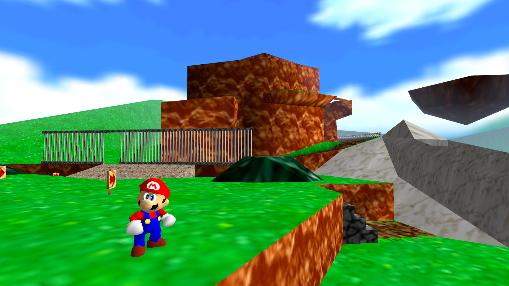

# sm64-rs

An independent native Rust reimplementation of **Super Mario 64**, working toward
behavior fidelity. Bevy handles presentation; gameplay rules belong in engine-free
Rust. **This is not an emulator, and the viewer is not playable yet.**

The current showcase renders **Mario in a static idle pose inside textured Bob-omb
Battlefield**, with the ROM's ocean sky, a composed camera and approximate
lighting/fog. A separate, narrow headless movement slice has been compared against
original-game observations. No ROMs, Nintendo code, extracted assets or captured
game states are distributed.

[](docs/images/showcase.png)

*Showcase screenshot — derived work containing Nintendo-owned game imagery,
not covered by the project's code licenses. Static scene, not playable gameplay.*

## Quick start

Install a recent stable [Rust toolchain](https://rustup.rs/). Linux also needs a
C toolchain and window-system build dependencies:

```sh
# Debian/Ubuntu
sudo apt-get install build-essential pkg-config libx11-dev libxkbcommon-dev libwayland-dev
# Arch equivalents: base-devel pkgconf libx11 libxkbcommon wayland
```

From this checkout, point the viewer at a ROM you are legally entitled to use:

```sh
cargo run -p sm64-viewer -- --rom /path/to/your/rom.z64 --showcase
```

Or set `SM64_ROM` and omit `--rom`. The showcase requires the exact **US revision
0** identity, checked by canonical hash—not the filename. Big-endian, pair-swapped
and word-reversed images are recognized by their bytes. Archives are unsupported.
No tool downloads a ROM, patches it or writes to the supplied image.

The interactive viewer needs a graphical session and working graphics driver.
Linux/Vulkan has been checked locally; other platforms/backends are not validated.

**Controls:** RMB look · WASD fly · Q/E down/up · Shift faster · R reset view ·
H labels · V collision view · C collision edges · Esc exit.
Mario stays still; these controls move an inspection camera, not the character.

### Make a screenshot

```sh
mkdir -p .cache
cargo run -p sm64-viewer -- --rom /path/to/your/rom.z64 --showcase \
  --shot .cache/showcase.png
```

This renders a **1920 × 1080 PNG without creating a window**, then exits. It needs
a working GPU/driver but no display server. Choose another size with `--width` /
`--height`; use a **new PNG path** each time. Existing files are never overwritten.
Generated imagery and logs stay in ignored local directories, except for the
explicitly labelled showcase screenshot above.

See the [showcase guide](docs/showcase.md) for custom cameras, capture guarantees,
reproducibility checks and presentation limitations. No image is uploaded or
published by these commands.

### What this demonstrates—and what it does not

- **Implemented:** ROM-backed static terrain, a sampled center-idle Mario pose,
  sky tiles, selected material/decal handling, diagnostic collision views and
  fixed-resolution captures.
- **Approximate:** lighting, fog, filtering, contact shadow, sky projection and
  render-layer behavior. This is not pixel-identical N64 rendering.
- **Not implemented:** controllable Mario in BOB, animation playback, enemies,
  moving objects, gameplay progression, audio or the original camera.

The visual showcase and the validated movement experiment are separate. A static
Mario model is not evidence that general movement/collision already works.

## Inspection and headless simulation

The CLI can be built without Bevy's platform dependencies:

```sh
cargo run -p sm64x -- --rom /path/to/your/rom.z64 info
cargo run -p sm64x -- --rom /path/to/your/rom.z64 level bob --visuals --json
```

| Command (`cargo run -p sm64x -- …`) | Purpose |
| --- | --- |
| `info` | Header, byte order, canonical hashes and exact revision recognition |
| `level bob [--visuals]` | Static declarations/collision; optional geometry/texture metadata |
| `collision bob --at X,Y,Z` | Diagnostic geometric probes, not original collision resolution |
| `mio0 list --validate` | Scan and validate compressed-stream candidates |
| `mio0 decode 0x108a40` | Decode the first US0 block into a new ignored cache file |
| `movement run SCENARIO` | Run the bounded native flat-walk slice without a ROM |
| `trace validate PATH` | Validate an observation trace without a ROM |
| `trace compare EXPECTED ACTUAL` | Report first divergence; exact float bits by default |

Use `--help` for options and `--json` for structured reports. Keep ROM-derived
output in `.cache/`, `extracted/` or `traces/`. MIO0 signatures are not a complete
asset directory; stored header CRCs are not recomputed checksum verification.

The [movement slice](docs/movement-slice.md) implements idle → straight full-forward
acceleration → braking to first stop in an explicitly supplied flat lane. It
supports 10–30 forward ticks, fixed -Z yaw, neutral/(0,80) sticks and no buttons.
All 21 supported hold durations matched reference observations exactly; this does
not validate general actions, terrain collision or playable viewer movement.

Try the **authored synthetic** initialization/input example without a ROM:

```sh
cargo run -p sm64x -- movement run docs/examples/authored-movement.json
```

The optional [reference emulator tooling](docs/reference-emulator.md) is separate
research infrastructure, not part of the native runtime or normal tests.

## Development

```sh
cargo fmt --all --check
cargo clippy --workspace --all-targets --locked -- -D warnings
cargo test --workspace --locked
python3 scripts/check_publication.py --history
python3 -m unittest discover -s scripts/tests -v
python3 -m unittest discover -s scripts/reference_emulator/tests -v
```

Normal tests need no ROM, emulator, window or GPU at runtime. Python tooling uses
Python 3.11+ and the standard library. Ignored ROM tests are opt-in and skip when
`SM64_ROM` is unset. Read [CONTRIBUTING.md](CONTRIBUTING.md) before sharing data.

- [Showcase](docs/showcase.md) · [Architecture](docs/architecture.md) · [Roadmap](docs/roadmap.md)
- [Simulation/evidence boundaries](docs/simulation.md) · [Movement slice](docs/movement-slice.md)
- Formats: [ROM](docs/formats/n64-rom.md), [MIO0](docs/formats/mio0.md),
  [scripts/collision](docs/formats/level-scripts.md), [geometry](docs/formats/geometry-layouts.md),
  [Fast3D](docs/formats/fast3d.md), [Mario/animation](docs/formats/mario.md),
  [skyboxes](docs/formats/skyboxes.md)
- [Provenance policy](docs/adr/0001-provenance.md) · [Agent guidance](AGENTS.md)

## License

Original project code: **MIT OR Apache-2.0**. Super Mario 64 and its content belong
to Nintendo. This unofficial project is not affiliated with or endorsed by Nintendo.
See [LEGAL.md](LEGAL.md).
